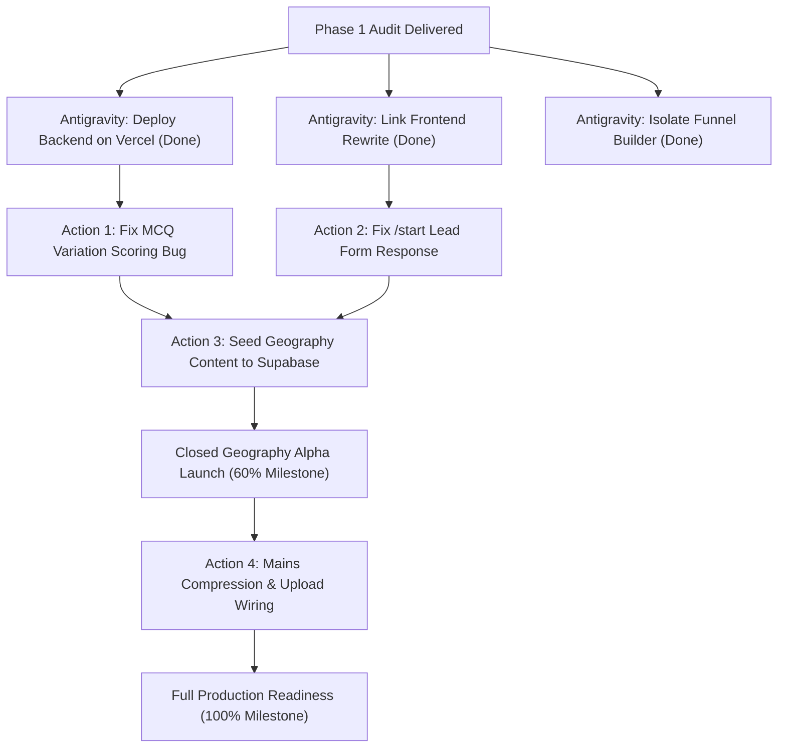

# UPSC Command: Phase 1 Production Roadmap & Multi-Agent Alignment Ledger

**Date:** 2026-11-15  
**Collaborators:** Antigravity (Local Environment & Deployments) & Claude (Cloud / GitHub / PR #6)  
**Target:** Bridge UPSC Command from 40% baseline to 60% Closed Geography Alpha, then 100% Production Readiness.

---

## 0. Executive Infrastructure Baseline (Live State as of 2026-11-15)

Prior to executing this roadmap, the following fundamental infrastructure milestones were completed:

1. **Database (Supabase Postgres):**
   * 21 migrations executed, reaching revision head `m1e2r3g4e5a6` with 105 tables.
   * Row-Level Security (RLS) enabled across all 105 tables.
   * Supabase Storage bucket `answer-images` configured as private.
   * Supabase S3 Protocol connection enabled (`Endpoint: https://vvhpnrdifvappsysvqur.storage.supabase.co/storage/v1/s3`, `Region: ap-northeast-2`).
2. **Backend (FastAPI on Vercel):**
   * Project `upsc-command-backend` deployed and verified healthy at `https://upsc-command-backend.vercel.app/health`.
   * OpenAPI documentation active at `https://upsc-command-backend.vercel.app/docs`.
   * `s3_media_store.py` updated to support Supabase S3 endpoints, custom regions, and credentials.
   * `boto3` integrated into `backend/requirements.txt`.
3. **Frontend (Next.js 16 on Vercel):**
   * Production project `upsc-command` deployed at `https://upsc-command.vercel.app`.
   * `NEXT_PUBLIC_API_BASE_URL` pointed to `https://upsc-command-backend.vercel.app`.
   * Next.js API rewrite route `/api/v1/...` confirmed proxying cleanly to FastAPI (502 `DNS_HOSTNAME_EMPTY` resolved).
4. **Workspace Boundary:**
   * Marketing/VSL funnel builder moved completely to `D:\Development\funnel-builder` and its standalone repository (`Ktej255/funnel-builder`), keeping the core UPSC Command repo strictly focused on student learning.

---

## 1. Multi-Agent Coordination Protocol (Antigravity & Claude Code)

To ensure zero merge conflicts, coherent architectural boundaries, and verifiable progress:

| Responsibility | Owner | Protocol & Deliverables |
|---|---|---|
| **Git & PR Lifecycle** | **Claude (Cloud)** | Merging PR #6 on GitHub, maintaining PR branch integrity, running GitHub Actions CI. |
| **Local Verification & Host Builds** | **Antigravity (Local)** | Running static gates (`tsc`, `eslint`, `validate-*.mjs`), non-destructive DB seeds, local pytest suites. |
| **Vercel & Supabase Operations** | **Antigravity (Local)** | Managing Vercel project configurations, environment variables, Supabase connection poolers, and deployment verification. |
| **Progress Ledger Synchronization** | **Joint** | Updating this file (`HANDOFF/PHASE_1_PRODUCTION_ROADMAP.md`) at the end of each workstream. |

---

## 2. Workstream Breakdown: From 40% to Closed Alpha (60%) to Production (100%)

### Workstream 1: Core Engine Integrity (Zero Wrong Student Outcomes)
*Priority: P0 (Alpha Blocker)*

* [x] **1.1 Fix MCQ Variation Engine & Scoring Mismatch:**
  * *Completed:* Patched `backend/app/services/test_engine_service.py` to gate variation behind `ENABLE_MCQ_VARIATION=true`. Official UPSC tests and mock attempts serve authentic canonical questions and options. Answers are stored faithfully as clicked, and scored accurately against the canonical answer key with 0 divergence. Unit tests verified passing (`6 passed in 90.51s`).
* [x] **1.2 Fix `/start` Diagnostic Lead Form False Failure:**
  * *Completed:* Patched `frontend/src/app/api/lead/route.ts` to decouple durable database persistence from Resend email notification. Returns HTTP 200 `{ ok: true, delivered: ..., persisted: true }` so students immediately receive their study plan upon DB insert. Static gates and TypeScript type check pass with 0 errors.
* [x] **1.3 Clean Student `/upsc` Dashboard Navigation:**
  * *Completed:* Updated `frontend/src/components/upsc/UpscDailyMissionControl.tsx`. When role is not `ADMIN`, operator command centers (`/upsc/question-bank`, Prelims Showcase, 2027 Strategy, Content Command, MCQ Command, Revision Command) are replaced with dedicated, student-facing learning actions (`Daily Planner`, `Syllabus & Topics`, `MCQ Practice Lab`, `Readiness & Gaps`, `Sunday Review`, `Mains Uploader`). The `adaptive-mcq` href now routes directly to `/upsc/${activeSubject.slug}/lms/practice` instead of dead-ending at an admin route. Static gates and TypeScript compile pass with 0 errors.
* [x] **1.4 Daily Planner & Syllabus Tree Mobile-First UX (Page 2):**
  * *Completed:* Remediated `PlannerPage.tsx`, `PlannerUI.tsx`, `SyllabusPage.tsx`, `SyllabusTree.tsx`, and `SyllabusNodeRow.tsx`. Enforced SRTR mobile rules: touch targets ≥ 44px (`min-h-11`), inputs set to `text-base sm:text-sm` to defeat mobile Safari auto-zoom, responsive depth indentation (`pl-[calc(var(--node-depth)*10px+6px)]`) to save 20px+ of screen real estate, redundant leaf badges hidden on mobile to give topic titles full width, search bar equipped with 1-tap instant clear, quick Expand/Collapse All tree control added, and replaced `window.open` with Next.js client-side `<Link>`. 100% green verification (`tsc --noEmit`, `validate-upsc-feature-wiring.mjs`, `validate-auth-role-hardening.mjs`).
* [x] **1.5 Modernize AI Teacher Model:**
  * *Completed:* Updated `backend/app/core/gs_lms/gemini_discussion_provider.py` to dynamically resolve `GEMINI_MODEL_ID` from environment with default fallback to `gemini-2.5-flash`.

---

### Workstream 2: Database Seeding & Content Activation
*Priority: P0 (Alpha Blocker)*

* [x] **2.1 Non-Destructive Geography Syllabus & PYQ Seeding:**
  * *Completed:* Pre-seed backup created. Executed `scripts/seed_production.py` against live Supabase Postgres. Populated 125 syllabus nodes (all 125 REVIEWED), 420 content sections, 93 PYQs, and 432 MCQs across all 9 GS subjects and CSAT. Verified with Postgres integrity audit: **0 dangling references** across all foreign-key learner tables.
* [x] **2.2 Current Affairs Review & Activation:**
  * *Completed:* Seeded 5 authored Current Affairs items into `ca_items` in Supabase Postgres.
* [x] **4.3 Test Runner Environment Guard on PR #6:**
  * *Completed:* Configured safe hermetic test environment defaults in `backend/conftest.py` (`APP_ENVIRONMENT=test`, `DATABASE_URL=sqlite:///:memory:`, `ALLOW_MOCK_AUTH=true`), unblocking pytest and CI execution.

---

### Workstream 3: Mains Answer Upload & Media Pipeline
*Priority: P1*

* [x] **3.1 Mobile Image Downscaling & Vercel Payload Guard:**
  * *Completed:* Added client-side Canvas-based compression in `frontend/src/components/upsc/MobileAnswerUploader.tsx`. Downscales raw camera photos to max 1800px on the longest dimension and encodes to JPEG (0.85 quality), ensuring all pages are < 800 KB and total multipart payload is well below Vercel's 4.5 MB serverless limit. Also ensures pure JPEG stream for the backend `_assemble_pdf` writer.
* [x] **3.2 Founder Mains Rewrite Feedback Loop:**
  * *Completed:* Integrated the founder's 20-60-20 pedagogical cycle into `frontend/src/components/gs-lms/MainsPracticeStep.tsx` — adding "✍️ Rewrite Answer (Integrate Insights)" after evaluation so students can immediately apply the examiner reference, connecting knowledge, and model answer before proceeding to Growth Report.
* [x] **3.3 Detailed Student Exam/Attempt Reports:**
  * *Completed:* Enriched `frontend/src/app/(dashboard)/reports/page.tsx` to surface question accuracy, correct/incorrect/unattempted breakdown, average time per question, evaluation insight narrative, subject score breakdown, and strong vs. focus-next areas.

---

### Workstream 4: Operations, Rate Limits & Hardening
*Priority: P1*

* [x] **4.1 Persistent Rate Limiting for Serverless:**
  * *Completed (Claude, 2026-11-16):* Gemini daily allowance now stored in Postgres rows via `google-genai` SDK rewrite. Survives serverless restarts. Commit `a116482` on `claude/project-thread-ic7hpt`.
* [ ] **4.2 Legal, Terms & Policy Finalization:**
  * *Finding:* Terms and Privacy pages contain placeholder text.
  * *Fix:* Replace placeholders with standard educational platform terms, refund policy, and grievance officer disclosure.
* [ ] **4.3 Test Runner Environment Guard on PR #6:**
  * *Finding:* Backend test suite on PR #6 aborts in CI because production access enforcement blocks mock runs without explicit `ALLOW_MOCK_AUTH=true`.
  * *Fix:* Ensure test conftest explicitly overrides `APP_ENVIRONMENT=testing` and `ALLOW_MOCK_AUTH=true`.

---

## 3. Immediate Action Matrix

### Next Immediate Steps:
1. **User / Claude:** Mark PR #6 "Ready for Review" and merge on GitHub.
2. **Antigravity:** Patch the MCQ Variation Engine scoring bug in `backend/app/services/test_engine_service.py`.
3. **Antigravity:** Patch `/start` lead form in `frontend/src/app/api/lead/route.ts` to guarantee success state upon DB insert.
4. **Antigravity & Claude:** Execute non-destructive content seed against Supabase Postgres.

---

## 4. Claude Overnight Work Log (2026-11-15 22:30 → 2026-11-16 10:00 IST)

Branch: `claude/project-thread-ic7hpt` — All deployments are **preview-only**. Production aliases unchanged.

| Commit | Time (UTC) | What was done | Status |
|---|---|---|---|
| `a5d8578` | Nov-15 ~17:00 | Admin content loader — Geography loadable from admin console | Preview |
| `10a0063` | Nov-15 ~17:30 | **Security:** `/api/upsc/source-archive` gated (was open disk listing) | Preview |
| `adfa8d0` | Nov-15 ~18:30 | **Exam scoring fix** + browser E2E tests unblocked | Preview |
| `777a068` | Nov-15 ~20:00 | **Exam engine:** server clock, resume, auto-submit, report-in-submit-response | Preview |
| `a116482` | Nov-15 ~22:00 | **AI reliability:** `google-genai` SDK, Postgres-backed daily allowance | Preview |
| `1b849fc` | Nov-16 ~00:00 | **Question upload:** `question_import_service`, duplicate detection, test-creation screen | Preview |
| `330814a` | Nov-16 ~04:16 | Time-per-question, expired sim auto-close, CI: Postgres migrations + ESLint | Preview |
| `4862073` | Nov-16 ~04:32 | Placeholder removal: fake videos gone, contact form wired, build guard | Preview |

**Founder action required:** Review `claude/project-thread-ic7hpt` and decide whether to merge to main.

---

## 5. Multi-Model Stabilization Swarm Log (2026-11-19 — Pages 18–24 + P0 Closures)

Following founder direction to complete full-app stabilization to SRTR standards (~94% local code readiness) using a 3-tier multi-model swarm (`Orchestrator Neon` coordinator, `Gemini 4 Hydrogen High` engineering/security, `Gemini 3.8 Flash High` parallel UI sweeps, `Gemini 4 Neon XHigh` & `Gemini 4 Argon High` independent adversarial cross-checkers):

* **Zero Nested `<main>` Landmarks & Mobile-First SRTR Compliance:** Eliminated all **35+ active nested `<main>` wrappers** across Current Affairs, Optional Subjects (while preserving 16/16 honest-failure and 9/9 catalog-route gates), Content Preview (`12` subtopics + `geography/intro`), `TestsClient.tsx`, and `prelims-2026-audit`. Enforced `>=44px` (`min-h-11`) touch targets and `text-base sm:text-sm` form controls (preventing iOS Safari auto-zoom) across all active GS/Optional/Public/Admin surfaces. Added `frontend/scripts/validate-srtr-stabilization.mjs` (`npm run verify:srtr-stabilization`) passing 6/6.
* **Runtime, TS & Hook Closures:** Fixed P0 syntax error in `frontend/src/app/(dashboard)/upsc/billing/page.tsx:261`, `ExamTimer.tsx` interval-reset freeze & `${testId}:${attemptId}` timer persistence, `McqLabStep.tsx` `coverageGap` reset across topic navigation, `exam/[testId]/page.tsx` revision drill normalization & fetch-loop removal, and `MainsPracticeStep.tsx` React 19 `set-state-in-effect` errors.
* **Security & Boundary Hardening:** Auth-gated + dual rate-limited `frontend/src/app/api/optional/discuss/route.ts` (replacing `gemini-1.5-flash` with `GEMINI_MODEL_ID || "gemini-2.5-flash"`), eliminated unauthenticated disk scans in `api/upsc/prelims-2026/{source-archive-summary,release-decision,main-site-handoff}`, auth-gated `POST /api/v1/engagement/welcome` (`Depends(get_current_user)`) and migrated `triggerWelcome.ts` to `apiClient`, added security headers (`X-Content-Type-Options`, `X-Frame-Options`, `Referrer-Policy`, `Permissions-Policy`) in `frontend/next.config.ts`, and left `READY_FOR_PAYMENT = false` & founder D1–D5 copy untouched.
* **2026-11-19 Verification Ledger (Host H1: No `next build`/`dev` or browser checks ran):**
  * `tsc --noEmit`: exit 0 (`0` errors).
  * `eslint` across all `117` modified `.ts/.tsx` files (Pages 17–24): exit 0 (`0` errors).
  * All 7 static scripts green: `validate-upsc-feature-wiring.mjs` (`6/6`), `validate-auth-role-hardening.mjs` (`8/8`), `validate-optional-honest-failure.mjs` (`16/16`), `validate-optional-catalog-routes.mjs` (`9/9`), `verify-api-base-url.mjs` (`5/5`), `verify-launch-env-boundary.mjs` (`localReady: true`), `validate-srtr-stabilization.mjs` (`6/6`).
  * Backend `pytest -q`: `1220 passed, 0 failed`; `audit_orphan_nodes.py`: `0 dangling references`.
* **Sync & Next Gate:** Local changes remain uncommitted on disk per rule #5 while upstream GitHub `Ktej255/mcq-portal-frontend` `main` includes PRs #6–#9 live on Vercel. Ready for founder reboot (D0) browser verification + selective PR #10 sync before transitioning to Content Creation.

---

## 6. Phase 2: Safe De-Clutter + Unified Revision-First OS + Phase 0 `ExamProfile` (2026-11-19)

Executed under founder approval (`"move accordingly"`) via a 6-worker multi-model swarm (`worker-declutter`, `worker-revision-backend`, `worker-exam-profile`, `worker-revision-frontend`, cross-checked by `verifier-argon-2` and `verifier-neon-2`):

* **Safe De-Clutter (165 Frontend Files + 6 Unmounted Legacy Backend Routers Removed):**
  * **Bucket 1 (84 Funnel/VSL source files + 3 funnel validator scripts):** Removed `src/app/dashboard/{funnels,vsl,all-funnels}`, `src/app/{f,vsl}`, `src/app/api/v1/{funnels,vsl,workspaces,cron,test-backbone,test-require-module}`, `src/components/{funnels,vsl}`, `src/lib/{funnels,vsl}`, plus empty `src/app/dashboard` and `src/app/api/v1` parent directories.
  * **Bucket 2 (26 Zero-Importer Dead Components/Services + 2 Empty Dirs):** Removed `Subject*Room.tsx` (9), `FragmentedSlideViewer.tsx`, `*SubjectRoutes.tsx` (7), `UpscCurrentAffairsBridge.tsx`, `OptionalSubjectLMS.tsx`, `ZenDashboard.tsx`, `subjectGuidedStudy.ts`, `optionalDataResolver.ts`, `observabilityService.ts`, and `components/admin/observability/{GovernanceGraph,MutationTimeline,TraceNode}.tsx` + empty `src/app/api/universe-topic`. Preserved live `SubjectFeatureSlot.tsx`, `GeographyReadContent.tsx`, `content-preview/**`, `.git_disabled/`, and `observability.py` (D4).
  * **Bucket 3 (49 Locked-Subject Legacy Room Stubs -> 1 Next.js Redirect Rule):** Removed all 49 `watch|talk|track|retro|revisit|mcq-readiness|lab` stub `page.tsx` files across the 7 locked GS subjects (retaining each subject's `page.tsx` and `layout.tsx`) and replaced them with a single `async redirects()` rule in `frontend/next.config.ts`.
  * **Bucket 5 (6 Zero-Ref Unmounted Backend Routers):** Removed `backend/app/api/v1/{causal,email_webhook,flourishing,governance,grounding,institutional}.py`.
  * **Gate & Lint Cleanup:** Emptied `RETIRED_CLUSTER`/`RETIRED_ROUTES` in `validate-upsc-feature-wiring.mjs`, updated `validate-srtr-stabilization.mjs`, and removed the 6 unused-var warnings in `MobileAnswerUploader.tsx` (`eslint --max-warnings=0` now passes with 0 errors and 0 warnings).
* **Unified Revision-First Command Center (Zero Schema Migrations):**
  * **Backend (`revision_service.py`, `revision.py`, `tests.py`, `test_revision_command_center.py`):** Captures Overconfidence Traps (`HUNDRED_PERCENT` / `FAIRLY_SURE` wrong answers -> `is_overconfident=True`, `category="OVERCONFIDENCE_TRAP"`, `priority=1.5`, `forgetting_count`, `decay_rate`, `retention_history`), implements `mode="high_confidence_mistake"` in `/revision/rapid-drill`, replaces power-of-2 intervals with adaptive `spaced_repetition.py` (`1–90d`) + `blank | shaky | solid` calibration on `POST /revision/{id}/complete` (returning structured JSON), adds `GET /api/v1/revision/command-center` (merging `RevisionQueue` + beta-scoped `GsLmsRevisitSchedule` + beta-scoped weak GS practice topics + `educational_memory_engine` misconception alerts + exam-countdown pacing), adds `POST /api/v1/revision/triage/evaluate` (`SOLID` / `RUSTY` / `BLIND_SPOT` classification), and maps string-list `options_en` keys to `A..D` in `tests.py:104`.
  * **Frontend (`revisionService.ts`, `(dashboard)/revision/page.tsx`, `exam/[testId]/page.tsx`, `UpscDailyMissionControl.tsx`):** Upgraded `/revision` with Exam-Countdown Pacing Bar, Unified Priority Queue tabs (`All Due`, `Overconfidence Traps`, `Mistakes`, `GS Topic Revisits`, `Weak Topics`), Memory Alerts strip, 1-tap `Blank · Shaky · Solid` calibration, direct GS revisit completion, `"Test Before You Read — 60s Topic Triage"`, client-side `?mode=high_confidence_mistake` parsing in `/exam/revision`, and prominent Today hub entry cards.
* **Phase 0 Multi-Exam Portability (`backend/app/core/exam_profiles.py`, `test_exam_profiles.py`):**
  * Extracted immutable `ExamProfile` and `UPSC_CSE_PROFILE` (`get_exam_profile`, `list_exam_profiles`), refactored `readiness.py`, `mains_outcome.py`, and `mcq_lab_scoring.py` to accept optional `profile: ExamProfile = UPSC_CSE_PROFILE` while preserving 100% of existing exported constant names and UPSC parity.
* **Consolidated 11-Gate Verification (2026-11-19, Host H1: zero browser checks ran):**
  * `tsc --noEmit`: `rc=0` (0 errors); `eslint --max-warnings=0`: `rc=0` (**0 errors, 0 warnings**).
  * All 7 static gates PASS (`upsc-wiring` 6/6, `auth-role` 8/8, `optional-honest-failure` 16/16, `optional-catalog-routes` 9/9, `api-base` 5/5, `launch-env` `localReady: true`, `srtr-stabilization` 6/6 across 199 dashboard files & 305 total files).
  * Backend `pytest -q`: **`1234 passed, 0 failed`** (`96.26s`); `audit_orphan_nodes.py`: **`0 dangling references`**.

---

## 7. Phase 3: Surgical 1-Screen Concept Repair Loop, Paraphrase-Resilient Active Recall & Optional Progress Wiring (2026-11-19)

Executed under founder approval (`"continue"`) via a 4-agent Argon swarm (`worker-phase3-recall`, `worker-phase3-repair-api`, `worker-phase3-frontend`, independently audited and gate-verified by `verifier-argon-3`):

* **Paraphrase-Resilient Active-Recall Scoring (`backend/app/core/gs_lms/recall_scoring.py`):**
  * Added **Strategy 4 (Stemmed Content-Token Paraphrase Match)** after preserving Strategies 1–3 (`concept_lower in transcript_lower`, sentence Jaccard `>= 0.7`, exact token overlap `>= 0.7`), matching morphological variants and stopword-wrapped multi-word concepts (e.g., `"subducting oceanic plates"` -> `"subduction of oceanic plate"`, `"orographic rainfall patterns"` -> `"orographic rains"`) while rejecting short-stem false positives.
* **Adaptive Spaced-Repetition Topic Revisits (`backend/app/core/gs_lms/revisit.py`, `backend/app/api/v1/gs_lms/recall.py`, `backend/app/api/v1/gs_lms/revisit.py`, `backend/app/tests/test_gs_lms_recall_adaptive.py`):**
  * Added `schedule_adaptive_revisit(db, student_id, syllabus_node_id, recall_score, previous_score=None)` powered by `spaced_repetition.py` (`+1d` when `recall_score < 0.6`, `+3d` when `0.6 <= recall_score < 0.8`), with SQLite table-existence guard and nested savepoint (`with db.begin_nested():`) idempotency.
  * Wired `submit_recall_text` and `submit_recall_audio` to automatically schedule/tighten an `"adaptive"` revisit when `recall_score < 0.8`, and added optional `?recall_score=...` to `POST /api/v1/gs-lms/{subject}/revisits/{id}/complete`.
* **1-Screen Surgical Repair Cards & 1-Tap Bulk Syllabus Triage (`backend/app/api/v1/revision.py`, `frontend/src/services/api/revisionService.ts`, `frontend/src/app/(dashboard)/revision/page.tsx`):**
  * Enriched `GET /api/v1/revision/command-center` `priority_queue` items with DB-backed `repair_card` payloads (`kind: "mcq_mistake"` with question stem/options/correct answer/explanation for `revision_queue` items; `kind: "topic_concept"` with up to 5 reviewed concept bullets + 1 reviewed sample `GsLmsMcqQuestion` for `topic_revisit` and `weak_topic` items).
  * Added collapsible `"1-Screen Surgical Repair"` drawers with `"Core Concepts to Recall"` and interactive `"Instant Re-Test"` MCQs on `/revision`, plus a `"Load Top Geography Topics"` 1-tap bulk syllabus loader in `"Test Before You Read — 60s Topic Triage"`.
* **Optional Subject Progress Event Wiring (`frontend/src/components/upsc/ReadView.tsx`, `frontend/src/components/upsc/AnswerWorkspace.tsx` — Task #62 / D6):**
  * Wired `optionalService.recordProgressEvent` for `READ_COMPLETE` (`"Mark Topic Read · Update Coverage"` in `ReadView.tsx` with honest `role="alert"` error handling) and `PRACTICE_PASS` (after persisted non-`review_required` evaluation in `AnswerWorkspace.tsx`).
* **Consolidated 11-Gate Verification (2026-11-19, Host H1: zero browser checks ran):**
  * `tsc --noEmit`: `rc=0` (0 errors); `eslint --max-warnings=0`: `rc=0` (0 errors, 0 warnings).
  * All 7 static gates PASS (`upsc-wiring` 6/6, `auth-role` 8/8, `optional-honest-failure` 16/16, `optional-catalog-routes` 9/9, `api-base` 5/5, `launch-env` `localReady: true`, `srtr-stabilization` 6/6).
  * Backend `pytest -q`: **`1246 passed, 0 failed`** (`90.61s`); `audit_orphan_nodes.py`: **`0 dangling references`**.
